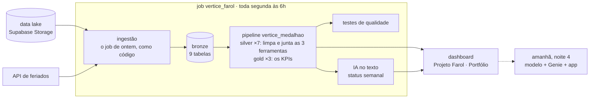
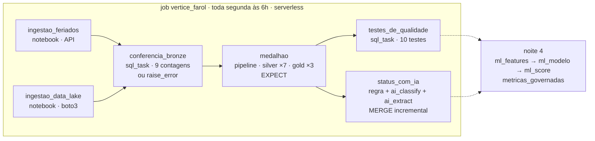
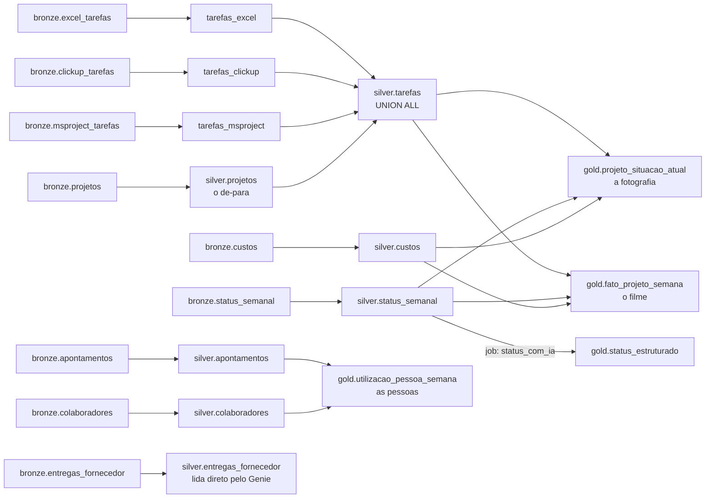

# 🤖 Claude Code: o job de ontem vira a Torre inteira (o bundle à mão + prompts 1 a 4) | Imersão Jornada de Dados

**Usado na noite 3 (quarta, 21/10).** O resumo da noite, o roteiro e os números estão no
[README da aula](../README.md). Aqui está o passo a passo para quem constrói junto.

**Ao fim desta noite você terá** a Torre de Controle da Vértice rodando sozinha, toda segunda às 6h:
o job de ingestão que você montou clicando ontem, agora como código; Excel, ClickUp e MS Project
juntos numa tabela só; os KPIs de prazo e custo calculados com teste; a causa de cada atraso tirada
do texto do status por IA; e um **dashboard** que o dono abre. Tudo em **cinco prompts no Claude Code**.

**Por que isso responde ao dono:** na segunda o Genie errou as quatro perguntas dele ("nenhum atraso
custa nada"), porque olhava dado sujo e espalhado. Hoje a gente constrói o dado limpo e testado
que faz ele acertar amanhã.

---

## 🏗️ O desenho do que você vai construir



<details>
<summary>O job tarefa por tarefa e o pipeline por dentro (para quem quer o detalhe)</summary>





</details>

---

## 🚀 Antes de tudo: o passo a passo, do zero

As noites 1 e 2 foram pelo navegador. A noite 3 precisa de **terminal** (a tela onde se digitam
comandos). Siga na ordem; cada passo termina com um comando que **confere** se deu certo.
Faça os passos 1 a 9 **antes da aula**: ao vivo, a gente começa direto no [passo 1, o bundle à mão](prd/bundle-na-mao.md).

### 🎥 Vídeos de referência

| Instalar o Antigravity e o GitHub, passo a passo | Databricks + IA, em detalhes |
|---|---|
| [](https://www.youtube.com/watch?v=8mcBuO6wo4U&t=3s) | [](https://www.youtube.com/watch?v=0l-DZkniRSg&t=1122s) |

**Passo 1 · O editor: Antigravity**

Baixe e instale em <https://antigravity.google>. É o editor onde você abre a pasta do projeto e usa o
terminal (menu **Terminal › New Terminal**). Qualquer editor com terminal serve (VS Code, Cursor).

**Passo 2 · Git e GitHub CLI**

```bash
# macOS
brew install git gh
# Windows (PowerShell)
winget install Git.Git GitHub.cli

git --version          # git version 2.x
gh auth login          # GitHub.com › HTTPS › Login with a web browser
gh auth status         # ✓ Logged in to github.com
```

Sem conta no GitHub? Crie em <https://github.com/signup> antes do `gh auth login`.

**Passo 3 · O seu repositório, do zero**

Não tem `git clone`: o projeto nasce vazio, na sua conta, e no fim da semana é o seu portfólio.
Quem cria a pasta é o próprio `databricks bundle init`, no [passo 1 da aula](prd/bundle-na-mao.md):
a pasta `~/projetos/vertice` já nasce bundle, e o `git init` vem logo depois. Antes da aula, só
crie a pasta-mãe:

```bash
mkdir -p ~/projetos
```

O material do curso (prompts, gabarito, slides) fica no GitHub: <https://github.com/lvgalvao/ImersaoControlTower>.

**Passo 4 · Python**

```bash
python3 --version      # 3.10 a 3.12. Evite o 3.13 com as bibliotecas do Databricks
```

**Passo 5 · A CLI do Databricks** (o programa que conversa com o seu workspace)

```bash
# macOS
brew tap databricks/tap && brew install databricks
# Windows (PowerShell)
winget install Databricks.DatabricksCLI
# Linux
curl -fsSL https://raw.githubusercontent.com/databricks/setup-cli/main/install.sh | sh

databricks -v          # Databricks CLI v0.250 ou mais nova
```

**Passo 6 · O login no workspace (o passo em que todo mundo tropeça)**

```bash
databricks auth login --host https://SEU-WORKSPACE.cloud.databricks.com --profile vertice
# abre o navegador: entre na sua conta do Free Edition e autorize
databricks auth profiles
# vertice   https://dbc-xxxx.cloud.databricks.com   YES
```

O endereço do workspace é o da barra do navegador quando você está no Databricks (até o `.com`).
O *profile* (`vertice`) é o apelido do login: **todo comando daqui em diante leva `--profile vertice`**.
Viu `refresh token is invalid` ou `Valid: NO`? Rode o `auth login` de novo.

**Passo 7 · Confira a bronze e o job de ontem**

```bash
databricks experimental aitools tools query "SHOW TABLES IN lakehouse_vertice.bronze" --profile vertice
# apontamentos, clickup_tarefas, colaboradores, custos, entregas_fornecedor,
# excel_tarefas, feriados, msproject_tarefas, projetos, status_semanal

databricks jobs list --profile vertice
# o job de ingestão da noite 2 aparece aqui (o nome varia: vertice_ingestao, Ingestão...)
```

Faltam tabelas ou o job? Faça a [noite 2](../../aula-02-python-engenheiro) primeiro: os dois
notebooks e o job de ingestão. O passo 1 começa importando esse job.

**Passo 8 · O Claude Code**

```bash
# macOS / Linux
curl -fsSL https://claude.ai/install.sh | bash
# Windows (PowerShell)
irm https://claude.ai/install.ps1 | iex

claude --version
claude                 # na RAIZ do repositório. Na primeira vez, faz o login
```

Instale as **skills oficiais do Databricks** no projeto (o "manual" que o Claude Code lê sobre bundles,
pipelines, metric views e funções de IA):

```bash
databricks aitools install --agents claude-code --scope project --skills-only --experimental
ls .claude/skills      # databricks-core, databricks-dabs, databricks-pipelines...
```

**Passo 9 · As travas, antes de dar acesso ao workspace**

Crie `.claude/settings.json` proibindo o que não tem volta:

```bash
cat > .claude/settings.json <<'JSON'
{
  "permissions": {
    "deny": ["Bash(databricks bundle destroy*)", "Bash(databricks bundle deploy --target prod*)",
             "Bash(git push --force*)", "Bash(rm -rf*)"]
  }
}
JSON
```

**Passo 10 · O bundle: o que é e quem cria**

O bundle é o projeto inteiro (job, pipeline, SQL) descrito em arquivos, com um `databricks.yml` na
raiz. A CLI tem um gerador de esqueleto:

```bash
databricks bundle init                 # pergunta o template: default-python, default-sql, default-minimal...
```

**Hoje você roda o `bundle init` à mão**, com o template `default-minimal`, no passo 1 da aula. Ele
vem com `mode: development`, que prefixa todos os nomes com `[dev seu_nome]` e quebra os caminhos
da noite: o passo 1 troca o `databricks.yml` inteiro. Depois o `databricks bundle generate job` lê o
job de ontem do workspace e escreve o YAML e os notebooks. A partir do prompt 1, o ciclo é sempre o
mesmo, na raiz:

```bash
databricks bundle validate --profile vertice          # confere o YAML antes de subir
databricks bundle deploy   --profile vertice          # sobe o código para o workspace
databricks bundle run vertice_farol --profile vertice # roda o job
```

(O Claude Code roda esses comandos para você e pede licença antes de cada um: leia e aprove.)

**Passo 11 · Ao fim de cada prompt, salve no GitHub**

```bash
git add . && git commit -m "prompt 1: conferência e silver" && git push
```

Os prompts dizem "na raiz deste repositório": é a sua pasta `~/projetos/vertice`. Se um prompt não
entregar, o **gabarito** está em
<https://github.com/lvgalvao/ImersaoControlTower/tree/main/aulas/aula-03-modelagem-claude-code/claude-code/vertice>: compare o arquivo.

Pronto. Agora é prompt a prompt.

---

<!-- prompts:inicio · copiado de prd/prompt-02..05-*.md (o passo 1 é manual: prd/bundle-na-mao.md) (o texto completo, com o que falar e "se der errado", está em cada arquivo). Não edite aqui: edite o arquivo e copie de novo. -->
## 📋 Os prompts da noite, prontos para copiar

Cole um de cada vez no Claude Code, na raiz do seu repositório (`~/projetos/vertice`). Espere terminar,
confira o número e faça o commit (passo 11) antes do próximo. O `<perfil>` já está como `vertice`.
A bronze e o job de ingestão vêm da noite 2.

### Passo 1 · O bundle, à mão, com a CLI (~15 min, sem Claude Code)

Não é prompt: você digita cada comando (`bundle init default-minimal`, `bundle generate job`, as
chaves em `variable-overrides.json`, deploy e run). O passo a passo testado está em
[`prd/bundle-na-mao.md`](prd/bundle-na-mao.md).

### Prompt 1 · Conferência + silver: as três ferramentas viram uma (~2 min)

```
Leia o CLAUDE.md da raiz do repositório antes de começar. Use as skills
databricks-core, databricks-dabs e databricks-pipelines. Sempre --profile <perfil>.

O bundle vertice está na raiz deste repositório: eu criei à mão com a CLI.
Tem o databricks.yml (variáveis catalog, warehouse_id e as duas chaves do
data lake) e o job vertice_farol em resources/vertice.job.yml, importado do
job de ontem, com as tarefas ingestao_feriados e ingestao_data_lake. NÃO
mexa nas chaves, nem no .databricks/bundle/dev/variable-overrides.json, nem
no catálogo e nos schemas (já existem). Se um comando for recusado por causa
das chaves, pare e me mostre o comando para eu rodar com `!`.

0. Antes da silver, a conferência da bronze: src/conferencia/00-conferencia-bronze.sql,
   sql_task no warehouse ${var.warehouse_id}, tarefa conferencia_bronze no job,
   depois das duas ingestões. Confere as 9 tabelas contra a contagem esperada
   (seed 42): projetos 60 · status_semanal 3911 · excel_tarefas 1663 ·
   clickup_tarefas 2119 · msproject_tarefas 1260 · colaboradores 523 ·
   apontamentos 30883 · custos 23640 · entregas_fornecedor 640
   (bronze.feriados fica de fora: cresce a cada execução). Uma linha por
   tabela com esperado e obtido; se alguma divergir, raise_error() dizendo
   qual tabela e onde olhar (a saída da tarefa ingestao_data_lake).

Agora a silver: integrar as três ferramentas, limpar, tipar e declarar o
contrato.

Crie um pipeline Lakeflow Spark Declarative Pipelines em SQL:
resources/vertice_medalhao.pipeline.yml com name vertice_medalhao, catalog
${var.catalog}, schema silver, serverless: true, photon: true, e libraries com
um glob em ../src/silver/** (o prompt 2 vai acrescentar ../src/gold/**).

Use CREATE OR REFRESH MATERIALIZED VIEW (nunca CREATE OR REPLACE, que não
existe no pipeline) e CREATE TEMPORARY VIEW para as visões intermediárias.
Leia a bronze pelo nome completo lakehouse_vertice.bronze.<tabela>; dentro do
pipeline, referencie as tabelas silver só pelo nome. COMMENT em toda tabela.
Siga a tabela de sujeiras da seção 3 do CLAUDE.md.

Um arquivo por assunto em src/silver/:

01-projetos.sql — o cadastro do PMO (é o de-para da integração)
- data_inicio em yyyy-MM-dd e dd/MM/yyyy: coalesce de dois try_to_date.
- ferramenta escrita de 8 jeitos → 'excel', 'clickup' ou 'msproject'
  (guarde ferramenta_como_veio). codigo_ferramenta vazio → NULL.
- EXPECT data_inicio IS NOT NULL e ferramenta IN (...), FAIL UPDATE.

02-tarefas.sql — AS TRÊS FERRAMENTAS VIRAM UMA
Três CREATE TEMPORARY VIEW com as MESMAS colunas (projeto_id, ferramenta,
id_na_ferramenta, fase, tarefa, responsavel, inicio_baseline, fim_baseline,
inicio_real, fim_real, pct_como_veio, horas, status_na_ferramenta):
- tarefas_excel: projeto pelo de-para (codigo_ferramenta = arquivo) e, se o
  código faltar, o PRJ-xxx do nome do arquivo. Datas: com '/' é dd/MM/yyyy,
  senão é número de série do Excel: date_add(DATE'1899-12-30', CAST(x AS INT)).
  %: com '%' tire o '%' e troque vírgula por ponto; sem '%' é fração (× 100).
  Horas: tire o 'h'. TIRE a linha onde tarefa = 'TOTAL'.
- tarefas_clickup: projeto pelo de-para (codigo_ferramenta = list_id) e, se o
  código faltar, pelo nome da lista. Datas em milissegundos:
  to_date(timestamp_millis(CAST(x AS BIGINT))). % e baseline estão em
  custom_fields: filter(custom_fields, f -> f.name = 'Progresso (%)')[0].value
  (e 'Início baseline', 'Fim baseline', 'Fase'). Horas = time_estimate / 3600000.
  Status de 12 jeitos → concluida / a_fazer / em_andamento.
- tarefas_msproject: projeto pelo de-para (codigo_ferramenta = arquivo). Só
  Summary = 0 (as tarefas-resumo somam as de baixo). A fase é a última
  tarefa-resumo de OutlineLevel 1 antes da tarefa:
  last_value(CASE WHEN OutlineLevel = 1 THEN Name END, true) OVER (PARTITION
  BY arquivo ORDER BY UID). Baseline.Start/Finish, ActualStart/ActualFinish,
  PercentComplete, horas de 'PT40H0M0S'.
MATERIALIZED VIEW tarefas = UNION ALL das três, com tarefa_id
(projeto-ferramenta-id), pct_concluido = least(pct_como_veio, 100) e a flag
pct_veio_acima_de_100. EXPECT projeto_id IS NOT NULL (achou_o_projeto),
pct entre 0 e 100 e horas > 0, todos FAIL UPDATE.

03-status-e-custos.sql
- status_semanal: data_status DATE, farol em minúsculas (EXPECT farol IN
  ('verde','amarelo','vermelho') FAIL UPDATE), pct_concluido INT, flag
  status_vazio ('', 'N/A', 'ver ata da reunião') — NÃO descarte.
- custos: valor com 671 vírgulas decimais: replace(',', '.') ANTES do CAST,
  nunca try_cast. estorno (negativo) FICA, com a coluna estorno. semana =
  sexta da semana: date_add(date_trunc('WEEK', data), 4).

04-pessoas.sql
- colaboradores: COL0102, COL0257 e COL0433 aparecem duas vezes (nome e papel
  em CAIXA ALTA). Mantenha o cadastro com papel em minúsculas (row_number).
- apontamentos com semana = semana_inicio + 4 (sexta).

05-fornecedores.sql — entregas_fornecedor: a CodeForge vem de 4 jeitos
('CodeForge Consultoria Ltda', 'Codeforge Consultoria', 'CODEFORGE CONSULTORIA
LTDA', 'Code Forge Consultoria'): normalize (replace(lower(x), ' ', '') LIKE
'%codeforge%') e guarde fornecedor_como_veio. data_entrega vazia = em aberto
(não é sujeira). prazo_prometido_dias, prazo_real_dias,
dias_de_atraso_na_entrega, em_aberto e em_atraso (em aberto e data_prometida
antes de DATE'2026-10-16').

São 7 tabelas na silver, nem uma a mais: projetos, tarefas, status_semanal,
custos, colaboradores, apontamentos e entregas_fornecedor.

Acrescente ao job vertice_farol a tarefa medalhao (pipeline_task apontando
para ${resources.pipelines.vertice_medalhao.id}), depois de conferencia_bronze.

Rode e me mostre a saída:
  databricks bundle validate --profile <perfil>
  databricks bundle deploy --profile <perfil>
  databricks bundle run vertice_farol --profile <perfil>
E no fim, numa tabela: cada tarefa do job, quanto tempo levou e o resultado.
```

### Prompt 2 · Gold + testes: a modelagem (~3 min)

```
Continue o bundle na raiz deste repositório. A silver está pronta.
Agora a gold, no MESMO pipeline vertice_medalhao: acrescente o glob
../src/gold/** em libraries. Os arquivos da gold escrevem com o nome completo
lakehouse_vertice.gold.<tabela>; leem a silver pelo nome curto. COMMENT em todas.
O "hoje" é DATE'2026-10-16'. Nunca current_date().

src/gold/01-fato-projeto-semana.sql → lakehouse_vertice.gold.fato_projeto_semana
Uma linha por projeto e semana (sexta-feira), da semana do início até
2026-10-16 (sequence(..., INTERVAL 1 WEEK) + explode). Colunas:
- pv: orçamento × Σ horas × fração do baseline decorrida até a semana ÷ Σ horas
  (greatest(0, least(1, datediff(semana, inicio)/datediff(fim, inicio))))
- ev: orçamento × pct_concluido do status_semanal daquela sexta ÷ 100. Projeto
  concluído não publica mais: use o último % (last_value(pct, true) OVER).
- ac: custo real acumulado (silver.custos por semana, soma acumulada)
- spi = ev/pv, cpi = ev/ac (try_divide, 4 casas), eac = orcamento / cpi
- farol_do_gerente (o último farol publicado)
- horas_disponiveis, horas_apontadas e horas_ociosas da semana (apontamentos)
- EXPECT pv >= 0 e ev <= orcamento, FAIL UPDATE.

src/gold/02-situacao-e-pessoas.sql
- projeto_situacao_atual: a fotografia de 2026-10-16 de cada projeto (60
  linhas). Traz o cadastro (projeto = projeto_id · nome, cliente, segmento,
  tipo_projeto, ferramenta, gerente_projeto, valor_contrato, orcamento,
  data_inicio, data_fim_baseline, duracao_baseline_dias, status) e os KPIs
  calculados sobre silver.tarefas (o % de hoje das ferramentas): pv, ev, ac, spi, cpi, eac, estouro_previsto = greatest(eac - orcamento, 0),
  margem_projetada, atraso_projetado_dias, termino_projetado, situacao
  ('concluído' se status <> em_andamento; 'crítico' se SPI ou CPI < 0,8;
  'atenção' se < 0,9; senão 'ok'), farol_do_gerente (status de hoje),
  farol_calculado (regra do manual: verde >= 0,95; amarelo >= 0,90) e
  melancia (em andamento, farol do gerente verde e SPI < 0,9).
- utilizacao_pessoa_semana: pessoa × projeto × semana com nome, papel,
  senioridade, horas disponíveis, apontadas, ociosas, utilizacao,
  custo_ocioso (horas ociosas × custo_hora) e o spi_do_projeto naquela semana.
Não crie dim_projeto nem tabela gold de fornecedor: o cadastro já está na
projeto_situacao_atual, e fornecedor é lido direto da silver.entregas_fornecedor.

src/testes/testes.sql (sql_task) — cada teste com raise_error se falhar:
 1 os 60 projetos têm cronograma na silver.tarefas
 2 cada projeto veio de UMA ferramenta, a do cadastro do PMO
 3 as horas do Excel na silver = a soma das linhas de TOTAL das planilhas
 4 uma linha por pessoa na silver
 5 a CodeForge virou um fornecedor só
 6 a limpeza não mudou o custo total (bronze com replace = silver)
 7 os 60 projetos têm fotografia de hoje
 8 todo projeto em andamento tem SPI e CPI
 9 o EV de hoje do status semanal bate com o das ferramentas (diferença < 1%)
10 AC de hoje no fato = soma dos lançamentos até hoje

Acrescente ao job a tarefa testes_de_qualidade, depois de medalhao.

Rode e me mostre a saída:
  databricks bundle deploy --profile vertice
  databricks bundle run vertice_farol --profile vertice
```

### Prompt 3 · O job completo, com IA no texto do status

```
Continue o bundle na raiz deste repositório. A gold e os testes estão
prontos. Agora a última camada da noite, e o job inteiro rodando sozinho.

1. O texto livre do status vira coluna. Use as funções de IA na versão 2.0
   (map('version','2.0')); o resultado é VARIANT, lido com ':response'.

   src/ia/status_estruturado.sql (sql_task, caminho completo das tabelas)
   a. CREATE TABLE IF NOT EXISTS lakehouse_vertice.gold.status_estruturado com
      COMMENT em cada coluna: projeto_id, data_status, farol, causa_bloqueio,
      bloqueio, quem_destrava, dias_impacto (DOUBLE), metodo ('regra', 'ia' ou
      'palavra_chave'), texto_status, _classificado_em.
      NÃO é CREATE OR REPLACE: a tabela acumula, e a IA não pode ser refeita
      a cada execução.
   b. MERGE INTO ... WHEN NOT MATCHED THEN INSERT, só com os status da
      silver.status_semanal que ainda não estão na tabela (LEFT ANTI JOIN por
      projeto_id e data_status). Para cada status:
      - metodo = 'regra' se status_vazio ou se o texto (minúsculas) diz
        'bloqueios: nenhum', 'sem bloqueios' ou 'nada relevante';
        'ia' se data_status >= DATE'2026-07-18' (últimos 90 dias);
        senão 'palavra_chave'.
      - causa_bloqueio: 'nao_reportado' se vazio; 'sem_bloqueio' na regra;
        na IA, ai_classify com a lista ["change_freeze","falta_sre",
        "dependencia_fornecedor","rotatividade","mudanca_escopo",
        "bug_retrabalho","aprovacao_cliente","sem_bloqueio"]; na
        palavra-chave, RLIKE: freeze|congelamento|janela de deploy →
        change_freeze; sre|infraestrutura|ambiente de homologação → falta_sre;
        forge|consultoria|fornecedor → dependencia_fornecedor; saída de|
        rotatividade|onboarding → rotatividade; escopo|change request|regra de
        negócio → mudanca_escopo; bugs|regressão|refazendo → bug_retrabalho;
        aprovação do cliente|homologação do cliente → aprovacao_cliente.
      - só na IA: ai_extract com JSON schema tipado: bloqueio (string),
        quem_destrava (string), dias_impacto (number, "1 semana = 7").
      - dias_impacto fora da IA: regex em 'impacto estimado de N dias' e
        'impacto estimado: 1 semana' (= 7).
   c. No fim, um SELECT de leitura: quantos status por metodo e causa.

   Acrescente ao job a tarefa status_com_ia, depois de medalhao (em paralelo
   com testes_de_qualidade).

2. O job inteiro
   - confira em resources/vertice.job.yml a ordem: ingestao_feriados e
     ingestao_data_lake em paralelo → conferencia_bronze → medalhao →
     testes_de_qualidade e status_com_ia em paralelo
   - agendamento toda segunda às 6h (America/Sao_Paulo); no dev ele fica
     pausado pelo preset, e está certo
   - max_concurrent_runs: 1 (duas execuções ao mesmo tempo apagariam a
     bronze uma da outra)
   - atualize o comentário do topo com as 6 tarefas e o que cada uma faz

Rode e me mostre a saída:
  databricks bundle validate --profile vertice
  databricks bundle deploy --profile vertice
  databricks bundle run vertice_farol --profile vertice
E no fim, numa tabela: cada tarefa do job, quanto tempo levou e o resultado.
```

### Prompt 4 · O dashboard: o dono vê a Torre (~10 s de deploy)

```
Continue o bundle na raiz deste repositório. O job está pronto e a gold
atualizada. Agora o dashboard, como código. Use a skill
databricks-aibi-dashboards.

1. scripts/gerar_dashboard.py gera resources/dashboard-portfolio.lvdash.json
   (AI/BI, GRID_V1). As queries da gold usam o nome de tabela PURO, sem
   catálogo nem schema; a silver.entregas_fornecedor vai com o nome completo
   lakehouse_vertice.silver.entregas_fornecedor. Três páginas:

   Portfólio
   - KPIs da carteira em andamento, calculados na projeto_situacao_atual
     (WHERE status = 'em_andamento'): carteira (SUM(valor_contrato)), SPI
     (SUM(ev)/SUM(pv)), CPI (SUM(ev)/SUM(ac)), estouro previsto, projetos em
     risco (atenção + crítico), críticos e melancias. Razão é SUM/SUM, nunca
     AVG de razão.
   - barra de estouro previsto por projeto, colorida por situação
     (crítico #FF5F46, atenção #F6C344, ok #22C2F4)
   - dispersão SPI × CPI, um ponto por projeto
   - linha de SPI e CPI semanais da carteira (SUM(ev)/SUM(pv) por semana no
     fato_projeto_semana, a partir de 2025-03-07)
   - tabela dos projetos em andamento com o farol do gerente ao lado do
     farol pelo número e a coluna melancia

   Pessoas
   - top 15 pessoas por custo da hora parada (utilizacao_pessoa_semana,
     semana > 2026-07-24, as últimas 12 semanas)
   - tabela de utilização por pessoa e projeto, da mais parada à mais ocupada
   - barras de causas de bloqueio por projeto (status_estruturado, últimos
     90 dias, sem 'sem_bloqueio' e 'nao_reportado')

   Fornecedores (sobre silver.entregas_fornecedor)
   - tabela por fornecedor: grafias no cadastro, entregas, prazo real ÷
     prometido, % no prazo, em atraso hoje
   - tabela das entregas em atraso hoje

   Tema nas cores da Jornada: #0059DB, #22C2F4, fundo #14141A no escuro.
   Um título de texto em cada página com a pergunta do dono que ela responde.

2. resources/dashboard.dashboard.yml: recurso dashboard_portfolio, display
   name "Projeto Farol · Portfólio", file_path para o JSON, dataset_catalog
   ${var.catalog}, dataset_schema gold, warehouse_id ${var.warehouse_id}.

Antes do deploy, rode cada query do dashboard (prefixando
lakehouse_vertice.gold. nas tabelas da gold) e me mostre a contagem de linhas
de cada uma e os valores dos KPIs.

Rode e me mostre a saída:
  python3 scripts/gerar_dashboard.py
  databricks bundle validate --profile vertice
  databricks bundle deploy --profile vertice
  databricks bundle summary --profile vertice
```

<!-- prompts:fim -->

---

## 🧾 Os prompts, um por um

Cada prompt termina com um **deploy**. Enquanto o Claude Code trabalha, o professor explica o
conceito: o tempo de espera vira aula. O texto exato de cada prompt está no arquivo (copie e cole);
a sequência inteira está em [`PROMPTS.md`](../../../PROMPTS.md). Antes de cada um, o Claude Code lê
[`prd/CLAUDE.md`](prd/CLAUDE.md): o negócio, as 18 sujeiras do dado, a arquitetura e as armadilhas
do Free Edition já medidas.

| # | Arquivo | O que entrega | Tempo |
|---|---|---|---|
| — | [`bundle-na-mao.md`](prd/bundle-na-mao.md) | o job de ontem como código (sem chave no Git) + conferência da bronze | ~4 min (a ingestão roda junto) |
| 1 | [`prompt-01-silver.md`](prd/prompt-01-silver.md) | pipeline, `silver.tarefas` + 6 tabelas | ~2 min |
| 2 | [`prompt-02-gold.md`](prd/prompt-02-gold.md) | 3 tabelas gold (fotografia, filme, pessoas) + 10 testes | ~3 min |
| 3 | [`prompt-03-job-completo.md`](prd/prompt-03-job-completo.md) | `status_estruturado` (ai_classify + ai_extract) e o job inteiro, de ponta a ponta | ~8 min |
| 4 | [`prompt-04-dashboard.md`](prd/prompt-04-dashboard.md) | o dashboard "Projeto Farol · Portfólio", 3 páginas | ~10 s de deploy |

Se um prompt não entregar, o **gabarito** está em [`vertice/`](vertice): compare o arquivo.

### Passo 1 · O bundle, à mão

O job de ontem vira código sem Claude Code: [`prd/bundle-na-mao.md`](prd/bundle-na-mao.md).
No fim, `vertice_farol` com 2 caixas verdes, `git status` sem chave e o job de ontem pausado.

### Prompt 1 · As três ferramentas viram uma

> **A entrega mais importante da noite. Não corte.**

**O que você pede:** um pipeline declarativo (`vertice_medalhao`) que lê as três ferramentas, limpa
cada uma do seu jeito e empilha todas na `silver.tarefas`, com as **mesmas colunas**.

**A ideia, em três frases:**

- **A integração é um contrato de colunas.** Excel, ClickUp e Project viram, cada um, uma visão com
  as mesmas colunas (projeto, fase, tarefa, datas, %, horas). Depois é só empilhar. A ferramenta
  nova que aparecer amanhã é só mais uma visão.
- **O de-para é dado, não código.** Quem diz que a lista `901200095028` do ClickUp é o PRJ-012 é o
  cadastro do PMO. Se o código falta, o pipeline casa pelo nome do arquivo ou da lista.
- **`EXPECT` é contrato.** Se uma tarefa ficar sem projeto, ou um % passar de 100, o pipeline para
  em vez de gravar errado.

**Por que juntar à mão não serve como produto:** funciona, mas é frágil. Esqueça a linha
de `TOTAL` da planilha e as horas do Excel dobram. Esqueça as tarefas-resumo do Project e as horas
dobram de novo. Use `try_cast` no custo com vírgula decimal e **R$ 5,4 milhões somem sem erro**
(187,94 em vez de 193,35). O prompt 1 escreve cada uma dessas regras uma vez, com teste.

**O que conferir:**

```sql
SELECT ferramenta, COUNT(DISTINCT projeto_id) AS projetos, COUNT(*) AS tarefas
FROM lakehouse_vertice.silver.tarefas GROUP BY 1;
-- excel 20 · 1.643 | clickup 25 · 2.119 | msproject 15 · 1.155

SELECT ROUND(SUM(valor) / 1e6, 2) FROM lakehouse_vertice.silver.custos;   -- 193,35: o custo não mudou
```


*O grafo que o Lakeflow desenhou sozinho: `tarefas_excel`, `tarefas_clickup` e `tarefas_msproject` desaguando em `tarefas`. Embaixo, cada tabela com a duração e as linhas gravadas. (O print é do ensaio, antes da simplificação: ainda aparecem tabelas que saíram, como `dim_projeto`.) Clique numa tabela e abra **Data quality** para ver os `EXPECT`.*


*Em **Jobs & Pipelines**, busque `vertice`: o job `vertice_farol` (agendamento **Paused**, de propósito no ambiente de desenvolvimento) e o pipeline `vertice_medalhao`. As bolinhas vermelhas são execuções que falharam no ensaio: faz parte.*

> *"Juntei vinte planilhas, vinte e cinco listas do ClickUp e quinze cronogramas do Project numa
> tabela só. Nenhuma tarefa ficou sem projeto, e o custo total não mudou um centavo. É esse o teste."*

### Prompt 2 · A gold responde às perguntas do dono

**O que você pede:** no mesmo pipeline, três tabelas gold, uma por pergunta:

- `projeto_situacao_atual`: a **fotografia de hoje** (16/10/2026), uma linha por projeto, com o
  cadastro (cliente, segmento, tipo, ferramenta, gerente, contrato, prazo), SPI, CPI, estouro
  previsto e a situação (crítico, atenção, ok).
- `fato_projeto_semana`: o **filme**, projeto × semana, para ver quem está piorando.
- `utilizacao_pessoa_semana`: as **pessoas**, do timesheet, para achar quem está parado.

E uma tarefa de **10 testes** que quebra o job se algum número não fechar. Fornecedor não ganha
tabela gold: a `silver.entregas_fornecedor` já tem o nome normalizado e responde direto.

**A pergunta para a turma antes do prompt:** de onde vem o histórico? Excel, ClickUp e Project só
guardam o % de *hoje*. O único lugar com o % de cada semana é o **status semanal** que o gerente
publica toda sexta. Por isso o filme usa o status e a fotografia usa as tarefas.

**O que conferir:**

```sql
SELECT situacao, COUNT(*) AS projetos, COUNT_IF(melancia) AS melancias
FROM lakehouse_vertice.gold.projeto_situacao_atual GROUP BY situacao;
-- crítico 7 · atenção 10 (4 melancias) · ok 24 · concluído 19
```

O estouro previsto dos projetos em andamento dá **R$ 6,47 mi**, o mesmo do rascunho de ontem. E as
duas SREs paradas aparecem no timesheet: COL0017 e COL0018, a ~5% no PRJ-007, que ainda está no
desenho. É meia pergunta 3 do dono respondida (a outra metade vem no prompt 3).


*A gold no Catalog Explorer, com a descrição do schema. As tabelas desta noite são `fato_projeto_semana`, `projeto_situacao_atual`, `utilizacao_pessoa_semana`, `status_estruturado` e a metric view `mv_projetos`. (O print é do ensaio, antes da simplificação: ainda mostra tabelas que saíram, como `dim_projeto` e `cobertura_capacidade`, e as das noites 3 e 4.)*


*Aba **Lineage** › **See lineage graph**: a `projeto_situacao_atual` nasce de quatro tabelas silver (`projetos`, `tarefas`, `status_semanal`, `custos`) e alimenta a `mv_projetos`. (No print, do ensaio, ainda aparece a antiga `dim_projeto` no lugar de `projetos`.) Ninguém desenhou isso: o Unity Catalog anota sozinho.*

> **"Melancia"** é o projeto verde por fora e vermelho por dentro: o gerente marca farol verde, mas o
> SPI está abaixo de 0,9. São 4: PRJ-012, PRJ-028, PRJ-034, PRJ-042.

### Prompt 3 · O job completo: a Torre roda sozinha, e lê o texto do status

**O que você pede:** a última camada da noite, a `status_estruturado`, que lê o texto livre do status
semanal e tira a **causa do bloqueio**, o bloqueio, quem destrava e os dias de impacto. E o job
inteiro, da ingestão aos testes, rodando de ponta a ponta, agendado para toda segunda às 6h.

**A ideia:**

- **`ai_classify` escolhe; `ai_extract` tira.** A classificação põe o texto numa lista fechada
  (`falta_sre`, `change_freeze`, `mudanca_escopo`…), e aí dá para contar. A extração tira campos com
  tipo: "1 semana" vira o número 7, e aí dá para somar.
- **IA custa, e custa por linha.** Os 3,9 mil status levariam uma hora de warehouse. Então: **regra**
  para o que tem padrão fixo (a semana sem bloqueio, o status vazio), **IA** só para o texto com
  bloqueio dos últimos 90 dias (163 status, ~2 min) e **palavra-chave** para o histórico antigo.
- **Incremental.** A tabela guarda o que já foi lido. Rode de novo e ela processa zero linhas: a
  conta de IA não se paga duas vezes.
- **O DAG é a documentação.** Testes e IA rodam em paralelo depois do medalhão, porque um não lê o
  outro. Se uma tarefa falhar, o **Repair run** refaz só ela e as seguintes.

**O que conferir:** seis caixas verdes no `vertice_farol`, e a pergunta "por que o PRJ-011 atrasou?"
com resposta em dado.

```sql
SELECT causa_bloqueio, COUNT(*) AS semanas, SUM(coalesce(dias_impacto, 0)) AS dias_de_impacto
FROM lakehouse_vertice.gold.status_estruturado
WHERE projeto_id = 'PRJ-011' AND data_status >= DATE'2026-07-18'
  AND causa_bloqueio NOT IN ('sem_bloqueio', 'nao_reportado')
GROUP BY 1 ORDER BY 2 DESC;
-- falta_sre · 12 semanas · 57 dias de impacto declarado
```

Junto com o prompt 2, é a pergunta 3 do dono inteira: **duas SREs paradas no PRJ-007 enquanto o
PRJ-011 pede SRE no status há 12 semanas.**


*O job no ensaio de 18/10: `conferencia_bronze` → `medalhao` → duas tarefas **em paralelo** (`status_com_ia`, `testes_de_qualidade`). O seu tem ainda as duas caixas da ingestão na frente da conferência. (O print ainda mostra tarefas que saíram ou foram para a noite 4, como `postmortem_com_ia` e `metricas_governadas`.)*

### Prompt 4 · O dashboard: o dono vê a Torre

**O que você pede:** o dashboard "Projeto Farol · Portfólio", como código no bundle, com três
páginas: **Portfólio** (KPIs, estouro por projeto, SPI × CPI, a evolução semanal, o farol do
gerente ao lado do farol pelo número), **Pessoas** (quem está parado e as causas que a IA tirou do
status) e **Fornecedores** (quem promete e não cumpre).

**A ideia:**

- **Dashboard como código.** Um script (`scripts/gerar_dashboard.py`) escreve o JSON, e o JSON vai
  para o Git, dentro do bundle. Tem diff, revisão e rollback.
- **O SQL de cada gráfico cabe em cinco linhas.** Compare com o dashboard da noite 1: sem `CASE`,
  sem `replace`, sem `try_cast`. A limpeza mora na silver.
- **Razão não se soma.** O SPI da carteira é `SUM(ev) / SUM(pv)`, nunca a média dos SPIs. Amanhã
  essa fórmula vai morar num lugar só, a metric view, e o Genie e o app vão usar a mesma.

**O que conferir:** na página Portfólio, carteira de R$ 208,6 mi, SPI 0,92, CPI 0,97, estouro de
**R$ 6,47 mi**, 17 projetos em risco, 7 críticos e 4 melancias.


*A página **Pessoas**: a barra do PRJ-011 no topo, `falta_sre`, 12 semanas. Cada cor é uma causa que a IA tirou do texto.*

> **Não edite o dashboard no workspace.** O próximo `bundle deploy` recusa ("modified remotely").
> A mudança vai para o script, e o script gera o JSON.

---

## 🔢 Os números que devem aparecer na sua tela

O dado é gerado sempre igual (seed 42). Se um número seu divergir, o erro está no código, não no
dado. [`prd/99-verificacao.sql`](prd/99-verificacao.sql) confere tudo de uma vez (20 linhas):

```bash
python3 scripts/run_sql.py aulas/aula-03-modelagem-claude-code/claude-code/prd/99-verificacao.sql --profile <perfil>
```

| Métrica | Valor |
|---|---|
| Tarefas na silver | 4.917 (Excel 1.643 · ClickUp 2.119 · MS Project 1.155) |
| Custo real total (silver = bronze) | R$ 193,35 mi |
| Pessoas únicas | 520 (523 linhas no RH) |
| Grafias da CodeForge unificadas | 4 → 1 |
| Projetos em andamento · críticos · em atenção | 41 · **7** · **10** |
| SPI · CPI da carteira | 0,92 · 0,97 |
| Estouro previsto (em andamento) | **R$ 6,47 mi** (o mesmo do rascunho da noite 1) |
| Margem projetada da carteira | 20,4% |
| Melancias (farol verde, SPI < 0,9) | 4: PRJ-012, PRJ-028, PRJ-034, PRJ-042 |
| Entregas em atraso | 5, todas da CodeForge |
| CodeForge: prazo real ÷ prometido | 1,41 (0% no prazo) |
| SREs com < 20% de uso (12 semanas) | COL0017 e COL0018, no PRJ-007, ~450 h paradas cada |
| PRJ-011 nos últimos 90 dias | falta de SRE: 12 semanas, 57 dias de impacto |
| Status classificados por IA / regra / palavra-chave | 163 / 2.954 / 794 |

**Por que o estouro é igual ao da noite 1?** Porque a fotografia de hoje faz a mesma conta do
rascunho, sobre as mesmas tarefas. O que muda é que agora o número tem **contrato, teste e roda
sozinho**. E a noite 3 traz o que a noite 1 não tinha como fazer: o **histórico** (o fato semanal),
a **causa** (a IA lendo o texto) e as **pessoas** (o timesheet).


*A prova de que é um número só: na aba **Lineage**, a mesma `projeto_situacao_atual` alimenta o dashboard "Projeto Farol · Portfólio" (Downstream) e vem da silver (Upstream). (No print, do ensaio, também aparecem o Genie e a `mv_projetos`, que entram na noite 4.)*

---

## 🆘 Se der errado ao vivo

| Sintoma | Causa | Correção |
|---|---|---|
| `refresh token is invalid` | Login expirado | `databricks auth login --profile <perfil>` |
| O Claude Code recusa o deploy (*"Credential Leakage"*) | O modo automático barra comando que leva chave | Rode você mesmo, com `!` na frente: `! databricks bundle deploy --profile <perfil>` (o `!` roda na pasta onde o Claude Code está; sem `cd` relativo) |
| `no value assigned to required variable s3_access_key_id` | Faltou o arquivo das chaves | `.databricks/bundle/dev/variable-overrides.json` (bundle à mão, passo 4) |
| `ingestao_data_lake` falha com `preencha: [...]` | A chave não chegou como parâmetro | `base_parameters` com `${var.…}` na tarefa |
| A chave aparece no `git status` | `.databricks/` fora do `.gitignore` | Acrescente ao `.gitignore` antes do commit |
| `dev_fulano_silver` não existe | `mode: development` no target | `presets: { trigger_pause_status: PAUSED }` |
| Pipeline falha em `achou_o_projeto` | Arquivo que não casou com o de-para | Fallback pelo nome do arquivo (Excel) e da lista (ClickUp) |
| `CAST_INVALID_INPUT '1827,44'` | Vírgula decimal | `replace(',', '.')` antes do CAST |
| A tarefa de IA leva 15+ minutos | IA rodando no histórico inteiro | Filtro dos 90 dias + regra para "sem bloqueio" |
| Dashboard: `modified remotely` | Editado no workspace | Leve a mudança para o script e use `--force` só depois |
| Um prompt não entrega | — | O gabarito está em [`vertice/`](vertice): compare o arquivo |

Cada prompt tem a sua própria tabela "Se der errado", mais detalhada, no fim do arquivo.

**Para zerar e recomeçar**

```bash
bash aulas/aula-03-modelagem-claude-code/claude-code/prd/00-reset.sh <perfil>              # SIMULA: mostra o que sairia
BUNDLE_DIR=aulas/aula-03-modelagem-claude-code/claude-code/meu-vertice \
  bash aulas/aula-03-modelagem-claude-code/claude-code/prd/00-reset.sh <perfil> --apagar   # apaga silver, gold e os recursos do bundle
```

A bronze e o volume nunca são apagados: quem recarrega é a ingestão, a primeira tarefa do job.

**Para rodar o gabarito inteiro de uma vez**

```bash
cd aulas/aula-03-modelagem-claude-code/claude-code/vertice
# as chaves do data lake, fora do Git (os valores estão na tabela de conexão da noite 2)
mkdir -p .databricks/bundle/dev
echo '{"s3_access_key_id": "...", "s3_secret_access_key": "..."}' > .databricks/bundle/dev/variable-overrides.json
python3 scripts/gerar_dashboard.py
databricks bundle deploy --profile <perfil>
databricks bundle run vertice_farol --profile <perfil>    # ingestão, conferência, silver, gold, testes, IA (e, da noite 4, o modelo e a métrica)
python3 ../../../scripts/run_sql.py ../prd/99-verificacao.sql --profile <perfil>
```

O gabarito é o estado final da semana: o job já traz as tarefas da noite 4 (`ml_*` e
`metricas_governadas`) e o bundle já traz o Genie. Num workspace zerado, o Genie só sobe no
segundo `bundle deploy`, depois do `run`, porque precisa das tabelas.

---

## 📁 O que tem nesta pasta

| Caminho | O que é |
|---|---|
| `prd/CLAUDE.md` | contexto do projeto para o Claude Code |
| `prd/prompt-01..04-*.md` | os 4 prompts (o bundle à mão está em `bundle-na-mao.md`), com o que mostrar, o que falar e "se der errado" |
| `prd/99-verificacao.sql` | os 20 números da noite, esperado × obtido |
| `prd/00-reset.sh` | zera silver, gold e os recursos do bundle (simula por padrão) |
| `vertice/` | **o gabarito**: o bundle completo, testado |
| `vertice/src/ingestao/` | os dois notebooks da noite 2, agora dentro do bundle |
| `vertice/scripts/gerar_dashboard.py` | o dashboard gerado por código (o `gerar_genie.py` é da noite 4) |
| `meu-vertice/` | uma pasta de rascunho, se você quiser construir dentro deste repositório |
| `APRENDIZADOS.md` | o que falhou no ensaio do Free Edition e como foi resolvido |

## ➡️ Amanhã

A gold sabe dizer **quais projetos estão** em risco hoje. A pergunta 4 do dono é outra: **o que vai
dar errado no próximo mês?** A `fato_projeto_semana` tem a curva de cada projeto, semana a semana, e
o `status_estruturado` tem as causas: é o que um modelo precisa para aprender o padrão antes de ele
virar estouro. Amanhã o job ganha o modelo, o dono ganha um Genie que acerta as 4 perguntas e a Torre
ganha uma URL: o app. [Noite 4](../../aula-04-produtos-de-dados-ia).
