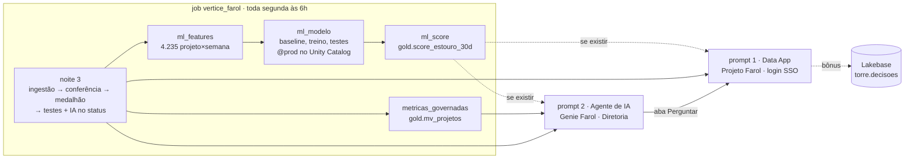

# 🔮 Noite 4 · Cientista de Dados e Engenheiro de IA | Imersão Databricks + Claude Code

> **Quinta, 22/10, 19h30** · 📺 gravação: _link após a live_
>
> **Pergunta da noite:** *"O que vai dar errado no próximo mês? E o dono, que não escreve SQL?"*
> **Formato:** a demonstração do modelo de ML, **2 prompts** no Claude Code (o agente e o app), no mesmo
> bundle da noite 3, o pitch e uma conversa sobre o mercado de trabalho.

## 🎯 O que a noite entrega

| | Entrega | O que o dono ganha | O Databricks por trás | Como |
|---|---|---|---|---|
| 🤖 | **O modelo de ML** | a chance de cada projeto estourar nos próximos 30 dias, com o motivo em português | Notebooks serverless · MLflow · modelos no Unity Catalog · Jobs | **demonstração** do instrutor (o prompt completo está no [bônus](bonus/prompt-modelo-ml.md)) |
| 📱 | **O Data App** | uma URL com o login da empresa: projetos em risco e simulador de realocação | Databricks Apps · AppKit · service principal | **prompt 1** · [`prompt-01-app.md`](prd/prompt-01-app.md) |
| 💬 | **O agente de IA** | pergunta em português e recebe a resposta com o número certo (e o SQL); vira a aba Perguntar do app | Genie Agents · Metric Views · AI Functions · Unity Catalog | **prompt 2** · [`prompt-02-agente.md`](prd/prompt-02-agente.md) |

E no fim, **o pitch de 3 minutos** para pedir o piloto ao dono ([`pitch.md`](pitch.md)) e **o que fazer com
isso no mercado de trabalho**. Para casa, em [`bonus/`](bonus): o prompt do modelo, a aprovação no
Lakebase e o agente que lê contrato.

**Por que isso fecha a história.** A noite 3 deixou a Torre rodando sozinha, com um dashboard. Mas ela
só sabe dizer quem **já** estourou, e as respostas ainda moram em tabelas que o dono não abre. Hoje a Torre
passa a **prever** (o modelo), a **conversar** (o agente) e a ter **endereço** (o app).

| Noite | O que ficou de pé | O papel |
|---|---|---|
| 1 | as 3 ferramentas no catálogo, SPI e CPI à mão, dashboard e Genie sobre a bronze | analista |
| 2 | a ingestão: data lake (S3/boto3) e API, num job | engenheiro |
| 3 | o job como código: silver, gold, testes, IA no status, dashboard | engenheiro com Claude Code |
| **4** | **o modelo (demonstrado), o agente e o app** | **cientista e engenheiro de IA** |

| Pergunta do dono | Onde a noite 4 responde |
|---|---|
| Quais projetos estão atrasados, e de quais clientes? | agente + app → **Projetos em risco** |
| Quanto esse atraso vai me custar? | agente (`mv_projetos`) + app (estouro previsto) |
| Tenho gente parada enquanto outro projeto pede gente? | agente + app → **Simulador** (COL0017 → PRJ-011) |
| O que vai dar errado no próximo mês, e o que eu faço agora? | **o modelo**, lido pelo agente e pelo app |

---

## 🎬 O caso da noite: PRJ-024, o projeto que "está ok"

A regra da Vértice é simples: **SPI ou CPI abaixo de 0,9 = atenção** (SPI mede o prazo, CPI mede o
custo; 1,0 é "no plano"). Para essa regra, o **PRJ-024 · Marketplace de sellers** está ok: SPI 0,91,
CPI 0,97.

Na demonstração do modelo, ele diz outra coisa:

> **PRJ-024 · 46% de chance de cruzar 0,9 em 30 dias.** Motivo: *"a 0,01 do corte de 0,9 (índice 0,91)"*.

E o calendário piora a conta: é o marketplace de um cliente de varejo. No freeze da Black Friday do ano
passado, o SPI dele caiu de **0,99 para 0,70**. O de 2026 começa em **01/11**, daqui a 15 dias, e trava
deploy. **O app (prompt 1)** põe o risco e o simulador na frente do dono, para mover uma SRE parada
para o PRJ-011. O modelo não sabe do calendário; **o agente (prompt 2) sabe**: a pergunta "o que vai dar
errado no próximo mês" junta o freeze e as entregas atrasadas da CodeForge.

Guarde esse projeto: é ele que a gente persegue a noite toda.

---

## 🏛️ Arquitetura



Leia assim: **o job ganha a metric view** (e, no gabarito do instrutor, as 3 tarefas do modelo), **o
agente lê tudo o que o job grava**, e **o app mostra e conversa**. A linha tracejada é o score: o agente e
o app usam se ele existir, e funcionam sem ele. A leitura vai ao SQL warehouse (a
gold); a escrita vai ao Lakebase (o Postgres).

**Onde fica cada coisa:** o laboratório do cientista (features, métricas, modelo) mora no schema
`lakehouse_vertice.ml`. Na `gold` entram só o resultado (`score_estouro_30d`) e a metric view.

---

## 0. Antes de começar (5 min)

- A noite 3 rodada: o bundle `vertice` na raiz do seu repositório `projeto-farol`, e o job
  `vertice_farol` verde (gold, `status_estruturado` e o dashboard).
- CLI do Databricks (`databricks -v` ≥ 0.250), Node 22+ (para o app) e Claude Code.
- Login: `databricks auth login --profile <perfil>`.
- **O Free Edition aceita no máximo 3 apps.** Rode `databricks apps list --profile <perfil>`; se já houver
  três, apague um que você não usa mais.
- Baixe o contexto da noite e as ferramentas do Genie para o seu repositório (na raiz do `projeto-farol`):

```bash
B=https://raw.githubusercontent.com/lvgalvao/ImersaoControlTower/main
mkdir -p aulas/aula-04-produtos-de-dados-ia/prd scripts
curl -fsSL -o aulas/aula-04-produtos-de-dados-ia/prd/CLAUDE.md $B/aulas/aula-04-produtos-de-dados-ia/prd/CLAUDE.md
curl -fsSL -o aulas/aula-04-produtos-de-dados-ia/prd/genie-benchmark-diretoria.json $B/aulas/aula-04-produtos-de-dados-ia/prd/genie-benchmark-diretoria.json
curl -fsSL -o scripts/genie.py $B/scripts/genie.py
```

**Como usar os prompts.** Abra o arquivo do prompt, copie o bloco da seção **"O prompt"** e cole no
Claude Code, na raiz do seu repositório, trocando `<perfil>` pelo seu. Cada prompt termina com um
deploy. Enquanto ele trabalha, leia a seção **"🧰 O que o Databricks oferece"** da entrega.

| # | Entrega | Deploy | Arquivo |
|---|---|---|---|
| 1 | **O Data App**: projetos em risco e simulador | `bundle deploy` + `apps deploy` | [`prd/prompt-01-app.md`](prd/prompt-01-app.md) |
| 2 | **O agente de IA**: `mv_projetos` e o Genie "Farol · Diretoria", com benchmark, plugado no app como a aba Perguntar | `bundle deploy` + `run` + `deploy`, e `apps deploy` | [`prd/prompt-02-agente.md`](prd/prompt-02-agente.md) |

> **Instrutor, antes da aula:** o job do gabarito rodado (com as tarefas `ml_*`, para a demonstração) e o
> `farol-torre` publicado: `bash aulas/aula-04-produtos-de-dados-ia/torre-app/scripts/subir-tudo.sh <perfil>`.

---

## 1. 🤖 O modelo de ML · demonstração (15 min)

**O problema.** A regra de corte acende quando o projeto **já** estourou. O dono quer saber 30 dias antes.

**Sem prompt ao vivo.** O instrutor mostra o modelo já rodado no gabarito: o notebook, o experimento no
MLflow, o modelo `@prod` no catálogo e a lista de segunda-feira. O prompt completo, testado, está em
[`bonus/prompt-modelo-ml.md`](bonus/prompt-modelo-ml.md): faça em casa, e o agente e o app passam a
mostrar a chance de estouro.

**O que abrir, nesta ordem:**

1. **Catalog** → `lakehouse_vertice.ml.features_projeto_semana`: uma linha por projeto e sexta-feira.
2. **Workspace** → o notebook `02-modelo`: os baselines impressos antes do treino, e os `assert`.
3. **Experiments** → `modelo_estouro_30d`: o run com as AUCs.
4. **Catalog** → `ml.modelo_estouro_30d`: as versões e o alias `@prod`.
5. **SQL Editor** → `gold.score_estouro_30d`: o PRJ-024 "ok" com 46%.

### 📖 As palavras do ML

| Termo | Em uma frase |
|---|---|
| **Rótulo** | a resposta que queremos prever: *"nas 4 semanas seguintes, o projeto caiu abaixo de 0,9?"* (1 = sim, 0 = não). |
| **Feature** | um sinal que o modelo olha para dar o palpite: o SPI de hoje, quanto ele caiu no mês, quantas pessoas saíram do time. |
| **Treino e teste** | o modelo aprende com uma parte do histórico e é cobrado numa parte que nunca viu. |
| **Corte no tempo** | o treino é o passado (até 06/03/2026) e o teste é o futuro (de 03/04/2026 em diante), como na vida real. |
| **Vazamento** | quando uma feature, sem querer, já sabe o futuro. O modelo fica brilhante no teste e inútil na segunda-feira. |
| **Baseline** | a regra simples que qualquer um usaria. O modelo só entra se ganhar dela. |
| **AUC** | uma nota de 0,5 a 1: 0,5 é jogar moeda, 1,0 é acertar sempre a ordem "quem estoura antes de quem não estoura". |
| **Score em lote** | o modelo roda uma vez por semana, dentro do job, e grava o resultado numa tabela. Ninguém chama o modelo ao vivo. |

### 🧰 O que o Databricks oferece para ML

O ciclo de um modelo tem sempre as mesmas quatro etapas. No Databricks, cada uma tem um lugar, e todas
moram no mesmo catálogo das tabelas da noite 3:

```
 features              treino                 registro                    uso
 (tabela no UC)  ──▶  (notebook + MLflow) ──▶ (modelo no UC, @prod)  ──▶  (score no job → tabela gold)
 ml.features_...      experimento, métricas    ml.modelo_estouro_30d       gold.score_estouro_30d
```

| Recurso | O que é | Como a Vértice usa hoje |
|---|---|---|
| **Notebooks serverless** | Python e SQL no navegador, sem cluster para ligar ou desligar. `%pip install` para trazer biblioteca. | `02-modelo.py` e `03-score.py` são notebooks; o Claude Code escreve, o job roda. |
| **SQL para features** | Feature é, quase sempre, uma janela no tempo: `lag()`, `AVG(...) OVER (... ROWS BETWEEN ...)`. O SQL do warehouse faz isso em segundos. | `01-features.sql`: 4.235 linhas, uma por projeto e sexta-feira, só olhando para trás. |
| **MLflow · experimentos** | O caderno de laboratório: cada treino vira um *run* com parâmetros, métricas (AUC) e o modelo salvo. Dá para comparar runs lado a lado na tela **Experiments**. | Um run por treino, com as AUCs do modelo e dos baselines. |
| **Modelos no Unity Catalog** | O modelo vira um objeto do catálogo, ao lado das tabelas: `lakehouse_vertice.ml.modelo_estouro_30d`. Tem **versões**, **alias** (`@prod`), permissão (`GRANT EXECUTE`) e linhagem, como uma tabela. | O score sempre lê `@prod`. Trocar de modelo = mover o alias, sem mexer no job. |
| **Lakeflow Jobs** | Treino e score são mais tarefas do mesmo job da noite 3. Se uma falha, as seguintes não rodam. | `ml_features → ml_modelo → ml_score`. Se o modelo não passar nos testes (`assert`), não é registrado e o score da semana passada fica. |
| **Score em lote × Model Serving** | Model Serving publica o modelo como uma API, para resposta em milissegundos. Score em lote roda o modelo sobre uma tabela inteira e grava o resultado. | Lote: a lista é semanal, e o Free Edition não serve modelo próprio (só os Foundation Models). |
| **Também existe (fora de hoje)** | Feature tables com *point-in-time join* (Feature Engineering no UC), AutoML, Model Serving com A/B. | Quando a Vértice tiver mais modelos usando as mesmas features, elas viram feature tables. |

**A ideia para levar:** no Databricks, o modelo **não é um arquivo no seu computador**. É um objeto
governado, com versão e permissão, treinado e usado pelo mesmo job que carrega o dado. Se o dado
mudar na segunda, o score muda na segunda.

### O que o gabarito faz (e o prompt do bônus pede)

1. `ml_features` (SQL): uma linha por projeto e sexta-feira, **só olhando para trás**, com o rótulo
   (o pior índice das 4 semanas seguintes ficou abaixo de 0,9?). 4.235 linhas, taxa base de **16,7%**.
2. `ml_modelo` (notebook): imprime os **baselines** antes de treinar, treina com **corte no tempo**, e só
   registra o modelo no Unity Catalog (`@prod`) se passar em 4 testes: ganha da regra, AUC ≥ 0,75,
   AUC < 0,98 (senão é vazamento), avisa ≥ 70% dos estouros.
3. `ml_score` (notebook): a lista de segunda-feira, `gold.score_estouro_30d`, com probabilidade, faixa
   e os motivos em português.

### A conversa é sobre as decisões, não o código

| Decisão | Por quê |
|---|---|
| projeto × semana, não projeto | com 60 projetos não existe ML; com 4.235 sextas-feiras, existe |
| feature só olha para trás | senão o modelo "cola" do futuro |
| corte no tempo, não aleatório | é assim que ele vai ser usado: treinado no passado, cobrado no futuro |
| o baseline primeiro | a regra "quem está mais perto do corte" já faz **0,87**. O modelo faz **0,92** |
| a métrica do dono | **9 de 10** estouros no top 5 da semana, em média **41 dias antes** |


*`gold.score_estouro_30d`: os 17 projetos que a regra já vê aparecem com 1,0; logo abaixo, os que a regra
diz "ok" e o modelo não. Repare na coluna dos motivos, em português.*

**A frase para o dono:** *"dos 10 projetos que estouraram depois de abril, a Torre teria colocado 9
na lista dos 5 mais arriscados da semana, em média 41 dias antes. Hoje, a regra de corte avisa zero
antes."*

---

## 2. 📱 Prompt 1 · O Data App (20 min)

**O problema.** O dono não abre SQL Editor. Quatro noites de trabalho estão atrás de uma tela que só o
time de dados usa. O Farol precisa de uma **URL**, e de um lugar onde a decisão acontece.

### 🧰 O que o Databricks oferece para apps (leia enquanto o prompt roda)

| Recurso | O que é | No app da Vértice |
|---|---|---|
| **Databricks Apps** | Hospeda um site dentro do workspace. Login com a conta da empresa (SSO), sem servidor, sem senha nova. | O app "Projeto Farol": uma URL que o dono abre no celular. No Free Edition, **3 apps** por workspace. |
| **AppKit** (Node + React + TypeScript) | O kit oficial: `databricks apps init` monta o projeto em ~10 s, com *plugins* prontos. | Plugin **analytics** (lê a gold) no prompt 1; plugin **genie** (o agente numa aba) no prompt 2. |
| **Leitura como arquivo `.sql`** | Cada consulta mora em `config/queries/*.sql`. O `typegen` lê o Unity Catalog e gera os tipos do TypeScript. | `kpis.sql`, `projetos_risco.sql`, `pessoas_ociosas.sql`. O `COMMENT` das tabelas vira documentação no editor. |
| **Apps em Python** | Streamlit, Dash, Gradio, FastAPI: a mesma hospedagem, outro framework. | Não usamos hoje; vale para quem prefere ficar em Python. |
| **Service principal** | O app é um **usuário robô** do Unity Catalog. Nasce sem acesso a nada. | `GRANT USE CATALOG / USE SCHEMA / SELECT` no `conceder-acesso.sh`. Sem isso o build falha: é a aula de governança. |
| **Autorização em nome do usuário** | Algumas ações o app faz **como você** (OAuth). No 1º acesso, a tela "Permission Requested". | No prompt 2, a aba Perguntar usa o Genie com a sua permissão. **Authorize** uma vez. |
| **Lakebase** | Um Postgres gerenciado pelo Databricks, para **escrever** uma linha por clique, na hora. | No bônus: a tabela `torre.decisoes`, com o e-mail de quem aprovou. No `farol-torre`, o botão Aprovar já grava. |

**Leitura no warehouse, escrita no Lakebase.** A gold é ótima para ler muito dado de uma vez e ruim
para gravar um clique por vez. O Postgres é o contrário. O app usa cada um para o que ele faz bem.

### Dashboard, agente ou app?

| | Dashboard (noite 3) | App (prompt 1) | Agente (prompt 2) |
|---|---|---|---|
| **Para quê** | acompanhar os mesmos números toda semana | um **fluxo** com regra de negócio e uma **ação** | responder a pergunta que ninguém previu |
| **Quem monta** | analista, arrastando | engenheiro (ou o Claude Code), com código | curadoria: tabelas + instruções + benchmark |
| **Exemplo da Vértice** | SPI, CPI e estouro da carteira | simular COL0017 → PRJ-011 e aprovar | "por que o PRJ-011 atrasou?" |

Os três leem a **mesma gold** e a **mesma fórmula** (`mv_projetos`). É isso que faz o número bater em
qualquer tela.

### O que o Claude Code faz

1. `databricks apps init` monta o esqueleto do app (React + TypeScript).
2. As leituras viram arquivos `.sql` em `config/queries/`. O score vem por uma rota do servidor (se a
   tabela faltar, a tela mostra "—" em vez de quebrar o build).
3. Duas telas: **Projetos em risco** (KPIs e a coluna P(estouro), "—" sem o modelo) e **Simulador** (pessoa
   ociosa → projeto que precisa). A terceira, **Perguntar**, entra no prompt 2.
4. `bundle deploy` cria o app e o **service principal**; `conceder-acesso.sh` dá a ele os `GRANT` na gold;
   `databricks apps deploy` publica o código.

> **Esperado:** sem os `GRANT`, o deploy falha com `INSUFFICIENT_PERMISSIONS`. Não é bug: é o robô sem
> permissão. Rode o `conceder-acesso.sh` e faça o deploy de novo.

> **20 minutos é apertado.** Cole o prompt e, **enquanto ele faz o build**, explique Apps, AppKit e o
> service principal. **Plano B:** o `farol-torre` publicado antes da aula. Se o deploy de alguém não
> terminar, a demo segue pela URL dele, e o aluno termina em casa.


*Depois do prompt 2, "Permission Requested": o app pede para agir em seu nome. Repare em "Manage your
genie spaces": é o que deixa a aba Perguntar usar o Genie como você. Clique **Authorize** uma vez.*

**O simulador mostra a conta.** O dono não aprova caixa-preta. Para COL0017 → PRJ-011:

- **151 h** no mês (as horas paradas × 4 semanas);
- **R$ 30,1 mil** de ociosidade que deixa de ser paga;
- **19,0 dias** de cronograma recuperados (dias de impacto da falta de SRE nos últimos 90 dias ÷ 90 × 30);
- **R$ 8,0 mil** de onboarding (40 h × custo da hora);
- **saldo de R$ 22,1 mil** no mês.

Os 19 dias ficam fora da conta em R$: sem uma multa ou receita atrelada, dia de cronograma não vira dinheiro.

---

## 3. 💬 Prompt 2 · O agente de IA (20 min)

**O problema.** Na segunda, o Genie da noite 1 errou as 4 perguntas ("nenhum atraso custa nada"). E o
CPI do mesmo projeto tinha três valores, dependendo de quem calculou. O dono não escreve SQL e não
confia em número que muda de acordo com quem perguntou.

### O que faz disso um agente

Um chat comum responde **de memória**, e por isso inventa. Um **agente** tem **ferramentas**: recebe a
pergunta, decide o que consultar, usa a ferramenta, lê o resultado e decide o próximo passo, até ter
a resposta. O agente da Vértice é um **Genie Agent**, e a ferramenta dele é o SQL:

```
"Quanto esse atraso vai me custar?"
   → lê as instruções (o que é "atraso", o que é "hoje")
   → escreve SQL na mv_projetos → roda no warehouse → R$ 6,47 mi
   → responde em português, com a tabela e o SQL que usou
```

No **modo Agent**, uma pergunta aberta ("o que vai dar errado no próximo mês?") vira várias consultas:
as entregas da CodeForge, o calendário de freeze e, se existir, o score do modelo. E ele **só enxerga o que o Unity
Catalog deixa a pessoa que pergunta enxergar**.

> **O modelo de linguagem é o mesmo da noite 1.** O que mudou é tudo que está embaixo dele: o dado
> integrado e testado, a fórmula escrita uma vez, o score e as instruções de negócio. Agente bom é
> **curadoria**, não modelo maior.

### 🧰 O que o Databricks oferece para IA (leia enquanto o prompt roda)

| Recurso | O que é | Na Vértice |
|---|---|---|
| **AI Functions** | IA dentro do SQL: `ai_classify`, `ai_extract`, `ai_query`, `ai_parse_document`. Roda em lote, sobre a tabela inteira. | Noite 3: o texto livre do status virou `causa_bloqueio` (163 status em 2 min). Bônus: os contratos em PDF viram colunas. |
| **Foundation Models** | Modelos de linguagem servidos pelo próprio Databricks, chamados por SQL ou API, sem servidor seu. | É o que as AI Functions chamam por baixo. |
| **Genie Agents** (antigo Genie Space) | O "chat com os dados", **curado**: você escolhe as tabelas, escreve as instruções, dá exemplos de SQL e mede com benchmark. | O agente **"Farol · Diretoria"**, recurso do bundle (versionado no Git). |
| **Metric Views** | A camada semântica no Unity Catalog: a **fórmula** do KPI, não o número. `MEASURE(cpi)` é sempre `SUM(ev)/SUM(pv)`, no grão que a pergunta pedir. | `gold.mv_projetos`: o agente, o SQL e o app usam a mesma fórmula. Acaba o "três CPIs". |
| **Unity Catalog** | Permissão, comentário e linhagem de cada tabela. O agente lê os `COMMENT` para entender as colunas. | Os `COMMENT` que a noite 3 exigiu viram o "manual" do agente. |
| **Agent Bricks** (Knowledge Assistant, Supervisor Agent) | Agentes prontos sobre documentos e orquestração de vários agentes. | No Free Edition viraram legado ("use Genie Agents instead"). Não criam mais. |
| **Para agente com código** | Vector Search (busca por significado, RAG), Agent Framework e MLflow 3 para avaliar agentes. | Fora de hoje. O benchmark do Genie é a versão simples da mesma ideia: avaliar antes de publicar. |

**Por que um Genie e não um agente escrito em Python?** Porque a pergunta do dono é sobre **dado
tabular**, e para isso o SQL é a ferramenta certa: a resposta é auditável (dá para ver o SQL), a
permissão é a do Unity Catalog, e não há servidor nem código de agente para manter.

### Curadoria: as 5 peças do agente

| Peça | O que é | Exemplo da Vértice |
|---|---|---|
| **Tabelas** | só o que ele pode ler | a gold, a `mv_projetos`, `silver.entregas_fornecedor` e o score (se existir) |
| **Instruções** | o contexto de negócio que não está em coluna nenhuma | HOJE = 16/10/2026; "gente parada" = utilização < 20% em 12 semanas; "próximo mês" junta score + CodeForge + freeze |
| **Exemplos de SQL** | uma resposta certa para cada pergunta-chave | as 4 perguntas do dono |
| **Sinônimos** (na metric view) | o vocabulário do dono | "índice de custo" = CPI; "farol mentiroso" = melancia |
| **Benchmark** | o teste do agente: 20 perguntas com o SQL certo | mudou a instrução? roda o benchmark. Abaixo de 16/20, corrige a **instrução**, não a pergunta |

### O que o Claude Code faz

1. A metric view `gold.mv_projetos` (tarefa `metricas_governadas` no job): SPI, CPI, estouro, margem,
   projetos em risco, melancias, como **fórmula**.
2. O agente **"Farol · Diretoria"** como recurso do bundle: tabelas, instruções, exemplos de SQL. O
   score entra só se a tabela existir.
   Ordem que importa: o Genie só nasce se as tabelas existem (deploy → run → deploy).
3. O benchmark: 20 perguntas, cada uma comparada com o SQL de referência (~6 min: rode enquanto explica a curadoria).
4. **Pluga o agente no app** do prompt 1: plugin `genie`, a aba **Perguntar** e `apps deploy`. Na volta ao
   app, "Permission Requested" → **Authorize**.


*"Tenho gente parada enquanto outro projeto pede gente?": o agente acha as duas SREs a ~5% no PRJ-007
enquanto o PRJ-011 está bloqueado por falta de SRE. (Print do ensaio de 18/10, antes do score.)*

---

## 4. 🎤 O pitch (10 min)

Três minutos, uma pergunta ao vivo, um número em reais. O roteiro, a tabela de ROI e as dicas estão em
[`pitch.md`](pitch.md). A demo amarra as entregas: o **modelo** dá 46% ao PRJ-024, o **agente**
explica o atraso do PRJ-011, e o **app** simula a SRE parada indo para lá.

---

## 5. 💼 E o mercado de trabalho? (10 min)

Na segunda, a premissa era: *você é o único profissional de dados da Vértice*. Em quatro noites você
fez o trabalho de quatro pessoas. **Cada noite é uma vaga:**

| Noite | O que você fez | O nome da vaga |
|---|---|---|
| 1 | SQL, KPI, dashboard, Genie sobre a bronze | **Analista de dados** / BI |
| 2 e 3 | ingestão, data lake, medalhão, testes, job como código | **Engenheiro de dados** / analytics engineer |
| 4 · modelo | rótulo, features, baseline, vazamento, MLflow | **Cientista de dados** / ML engineer |
| 4 · agente e app | Genie curado, benchmark, Databricks App, governança | **Engenheiro de IA** / engenheiro de produtos de dados |

Não é preciso entrar pelas quatro portas. Escolha a que mais gostou de fazer e aprofunde nela; as outras
três viram vantagem, porque você sabe o que o colega do lado precisa.

**O que já está pronto para mostrar:**

- **O repositório** `projeto-farol` no GitHub: o bundle, os testes, o job, os prompts. Um README que
  conta o problema (as 3 ferramentas, as 4 perguntas) vale mais que a lista de tecnologias.
- **A URL do app** e **o pitch de 3 minutos**: em entrevista, mostrar funcionando ganha de explicar.
- **Os números com fonte:** "o modelo avisa 9 de 10 estouros, 41 dias antes, contra 0 da regra atual".
  Resultado com número é o que o recrutador lembra.

**Como contar no LinkedIn ou no currículo** (troque pelo que você fez):

> Construí a Torre de Controle de Projetos de uma empresa de 60 projetos espalhados em Excel, ClickUp e
> MS Project: ingestão e medalhão no Databricks como código (Asset Bundles), KPIs de prazo e custo com
> testes, IA lendo o status semanal, um agente em português (Genie) e um app com simulador de
> realocação. Tudo construído com Claude Code.

**O próximo passo:** as certificações da Databricks (Data Analyst Associate, Data Engineer Associate,
Machine Learning Associate) seguem o mesmo caminho das noites, e o Free Edition que você usou serve para
estudar para elas.

## ✅ Confira

```bash
python3 scripts/run_sql.py aulas/aula-04-produtos-de-dados-ia/99-verificacao.sql --profile <perfil>       # tudo ok
python3 scripts/genie.py benchmark "Farol · Diretoria" \
  aulas/aula-04-produtos-de-dados-ia/prd/genie-benchmark-diretoria.json --profile <perfil>               # ≥ 16/20
```

---

## 🔢 O que deve aparecer na tela

| Entrega | O quê | Valor |
|---|---|---|
| modelo (demo) | `ml.features_projeto_semana` · treino · taxa base | 4.235 · 1.643 · 16,7% |
| modelo (demo) | Teste (a partir de 03/04/2026) | 580 projetos × semana, 70 terminaram o mês abaixo de 0,9 |
| modelo (demo) | AUC: regra da folga · classificador · **modelo** | 0,87 · 0,90 · **0,92** |
| modelo (demo) | Estouros avisados no top 5 · antecedência | **9 de 10** · **41 dias** |
| modelo (demo) | Score: alto · medio · baixo | 18 · 4 · 19 |
| modelo (demo) | Projetos "ok" para a regra com risco alto ou médio | 5 (entre eles PRJ-013, 0,89, e PRJ-024, 0,46) |
| modelo (demo) | Vazamento: corte no tempo · aleatório · com índice do futuro | 0,92 · 0,92 · **0,99** (barrado pelo teste de 0,98) |
| prompt 1 · app | em risco · críticos · melancias · estouro · alto risco em 30 dias | **17 de 41** · 7 · 4 · **R$ 6,5 mi** · 18 ("—" sem o modelo) |
| prompt 1 · app | Simulador COL0017 (PRJ-007) → PRJ-011 | 151 h no mês · R$ 30,1 mil de ociosidade evitada · **19,0 dias** recuperados · onboarding R$ 8,0 mil · saldo R$ 22,1 mil |
| prompt 2 · agente | `mv_projetos`: SPI · CPI · estouro · críticos · melancias | 0,92 · 0,97 · R$ 6,47 mi · 7 · 4 |
| prompt 2 · agente | Benchmark do "Farol · Diretoria" | 20/20 (18/10, antes do score); com o score: *a medir no ensaio* |

Tudo com `random_state=42` e seed 42: rodando de novo, dá igual. O job inteiro, com as 10 tarefas,
levou **9 min 55 s** no ensaio de 21/10.

### A pergunta-âncora, o que o agente deve responder

> *"O que vai dar errado no próximo mês?"* → as **5 entregas atrasadas da CodeForge** e o **freeze de 01/11**
> nos projetos de e-commerce (PRJ-003, 011 e 024). Com o score do modelo, também os projetos "ok" com
> risco alto ou médio, entre eles o **PRJ-024, 46%**, a 0,01 do corte.

---

## ⏱️ Roteiro da noite (90 min)

| Bloco | Min | O quê |
|---|---:|---|
| Abertura | 10 | o arco das 4 noites; as 4 perguntas do dono; o PRJ-024 "ok" no quadro |
| O modelo (demo) | 15 | a sala propõe as regras simples; o ML no Databricks; as 5 decisões; o PRJ-024 com 46% |
| Prompt 1 · o app | 20 | `apps list` (limite de 3), Apps, AppKit e o service principal durante o build, o GRANT ao vivo, a URL, o simulador |
| Prompt 2 · o agente | 20 | a mesma pergunta, três CPIs; o Genie da noite 1 errando; o que é agente; o benchmark; a aba Perguntar no app e o Authorize |
| Pitch | 10 | os 3 minutos, ao vivo, com a demo |
| Mercado de trabalho | 10 | as 4 vagas, o portfólio que já está pronto, o próximo passo |
| Folga | 5 | perguntas ou atraso |

**Se atrasar:** encurte a demo do modelo (só o PRJ-024 no score). Se o app travar, siga pelo `farol-torre`
publicado antes da aula. Nunca corte o pitch.

---

## 🧯 Se der errado

| Entrega | Sintoma | Causa | O que fazer |
|---|---|---|---|
| modelo (bônus) | `s3:PutObject ... explicit deny` ao registrar o modelo | o serverless vem com MLflow 2.11 | `%pip install -U "mlflow-skinny[databricks]>=2.21,<3"` + `restartPython()` na 1ª célula |
| modelo (bônus) | `AssertionError: perde da regra simples` | features erradas, ou o dado mudou | é o teste fazendo o trabalho dele: confira as features |
| modelo (bônus) | `AssertionError: bom DEMAIS` | feature que vê o futuro | procure `FOLLOWING` fora das colunas `alvo_`/`estoura_` |
| modelo (bônus) | `InvalidVersion: '18.x-aarch64-photon-scala2'` | `spark_udf` no serverless | `mlflow.sklearn.load_model` + pandas |
| agente | `metricas_governadas` falha no job, mas roda no `run_sql.py` | `;` dentro do YAML da metric view | a `sql_task` corta em todo `;`: tire o `;` |
| agente | `Table ... does not exist` no deploy | o Genie foi criado antes de a tabela existir | `bundle run vertice_farol` e deploy de novo |
| agente | `modified remotely` no deploy | o Genie foi editado no workspace | leve a mudança para o `gerar_genie.py`; `--force` só depois |
| app | `reached the maximum limit of 3 apps` | o Free Edition aceita 3 apps | apague um app que não usa mais |
| app | `apps deploy`: `INSUFFICIENT_PERMISSIONS` | service principal sem GRANT | `bash scripts/conceder-acesso.sh <perfil> minha-torre` e deploy de novo |
| app | `Requested node type [UNKNOWN] is not supported` | arquivo `*.geniespace.json` dentro do app | nenhum JSON de Genie dentro da pasta do app |
| app | O deploy do `vertice` demora e sobe milhares de arquivos | o app está dentro da pasta do bundle | `sync: { exclude: ["minha-torre/**"] }` no `databricks.yml` da raiz |
| app | App pede "Permission Requested" | consentimento OAuth (o Genie age em seu nome) | **Authorize**, uma vez |
| app | Tela com números sem formato | o warehouse devolve número como string | `num()` / `Number()` |

Limpar para ensaiar de novo:

```bash
bash aulas/aula-04-produtos-de-dados-ia/prd/99-limpar-modelo.sh <perfil> [--apagar]   # só o modelo (bônus)
bash aulas/aula-04-produtos-de-dados-ia/prd/99-limpar-aula-04.sh <perfil> [--apagar]  # o app (e o Lakebase do bônus)
```

---

## 🗂️ Arquivos

| Arquivo | Para que serve |
|---|---|
| `prd/CLAUDE.md` | contexto que o Claude Code lê antes dos prompts (junto com o `CLAUDE.md` da noite 3) |
| `prd/prompt-01-app.md` · `prd/prompt-02-agente.md` | os 2 prompts da noite, com o que mostrar, o que falar e "se der errado" |
| `prd/genie-benchmark-diretoria.json` | 20 perguntas com SQL de referência (o teste do agente) |
| `prd/99-limpar-modelo.sh` · `prd/99-limpar-aula-04.sh` | apagam só o modelo, ou só o app e o Lakebase |
| `99-verificacao.sql` | modelo, metric view e os números do app, esperado × obtido |
| `notebooks/01-o-que-o-modelo-vale.sql` | conferência: métricas, lista de segunda e a curva do PRJ-024 |
| `notebooks/02-o-vazamento-de-dado.py` | o mesmo modelo em 3 divisões: honesta, aleatória e com vazamento |
| `torre-app/` | o gabarito do app (e o plano B) |
| `minha-torre/` | onde você constrói o seu app (na raiz do seu repositório) |
| `bonus/` | para casa: o prompt do modelo de ML, a aprovação no Lakebase e o agente que lê contrato |
| `pitch.md` | o pitch de 3 minutos e o checklist de publicação |
| `APRENDIZADOS.md` | o que falhou no ensaio e como foi resolvido |
| Gabarito do ML, das métricas e do agente | [`../aula-03-modelagem-claude-code/claude-code/vertice/`](../aula-03-modelagem-claude-code/claude-code/vertice): `src/ml/`, `src/metricas/`, `scripts/gerar_genie.py` e as tarefas `ml_*` e `metricas_governadas` em `resources/vertice.job.yml` |
